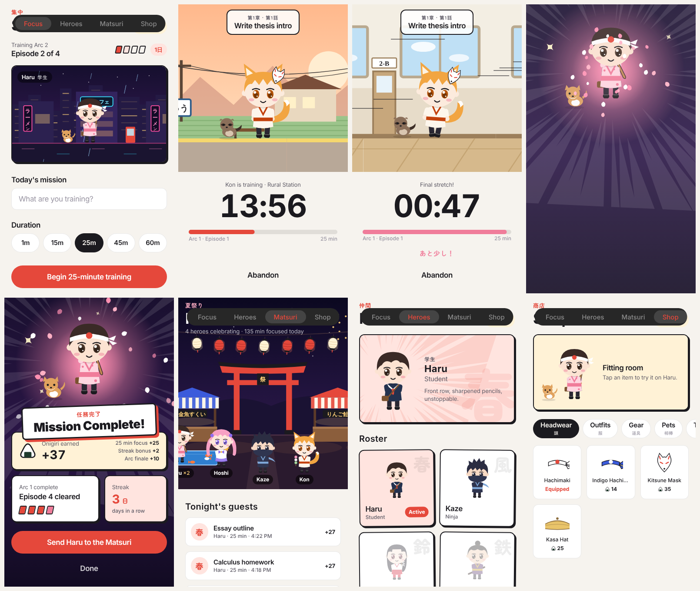

# Shūchū 集中

A Pomodoro focus timer where original anime-style chibi heroes train while you focus.



## Run it on the iOS Simulator (macOS + Xcode)

```bash
npm install
```

```bash
npx expo run:ios
```

`expo run:ios` builds a development build and opens it in the Simulator. Expo Go also works for now (`npx expo start`, then press `i`). Once Rive is added you'll need the development build, because Rive is a native module.

In dev builds there's a **1-minute** duration option, and **long-pressing the countdown** jumps to the last 65 seconds. Both let you check the final stretch and the success screen quickly.

## Languages

English and Brazilian Portuguese. The app follows the phone's language, and **Settings** (gear icon on the Focus tab) can override it. All strings live in `src/i18n/index.tsx`; the Portuguese dictionary is type-checked against the English one, so a missing translation fails `npx tsc`.

## Web preview

```bash
EXPO_OFFLINE=1 npx expo export -p web --output-dir dist-web
```

```bash
python3 scripts/build-preview.py dist-web preview/index.html
```

That builds one self-contained HTML file (needs `pip install fonttools brotli`).

## Structure

| Path | What |
| --- | --- |
| `app/(tabs)/index.tsx` | Focus setup: hero stage, mission, duration, scenery |
| `app/focus.tsx` | Running timer: parallax scenery, walking hero, final stretch run |
| `app/success.tsx` | "Mission Complete!" power-up (timeline documented at the top of the file) |
| `app/(tabs)/matsuri.tsx` | Night festival with today's finishers |
| `app/(tabs)/heroes.tsx` | Character selection / recruitment |
| `app/(tabs)/shop.tsx` | Cosmetics shop with a fitting room |
| `src/theme/tokens.ts` | **All design tokens.** Swap this file to apply the real design system |
| `src/chibi/HeroSprite.tsx` | **The Rive hand-off point.** Every screen renders characters through it |
| `src/chibi/Chibi.tsx` | SVG placeholder chibis (idle / walk / run / cheer) |
| `src/state/store.tsx` | Persisted state: onigiri, roster, cosmetics, sessions, arcs, streaks, language |
| `src/i18n/index.tsx` | English and Portuguese strings |
| `app/settings.tsx` | Settings sheet (language) |

## Rive integration

`HeroSprite` takes `heroId`, `mode` (`idle | walk | run | cheer`), `size` and `equipped`. To swap in Rive, build one artboard per hero (named in `characters.ts` → `riveArtboard`) with a `Locomotion` state machine that has a number input `mode` (0–3, see `MODE_INPUT`) and an input per cosmetic slot. No screen code needs to change.

## Motion rules followed

Reanimated 4 on the UI thread throughout, plus native stack and native tabs (no JS screen transitions). Press feedback is scale 0.97 over 120ms. UI uses a strong ease-out curve and never ease-in. Constant motion (scenery, petals) uses linear timing. Haptics fire once per semantic event, on the same frame as the visual. Every animation has a reduced-motion path.
